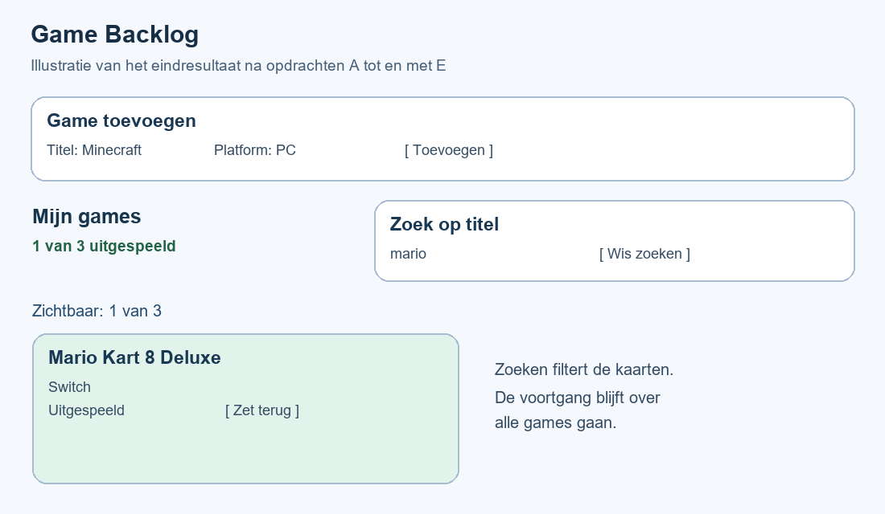
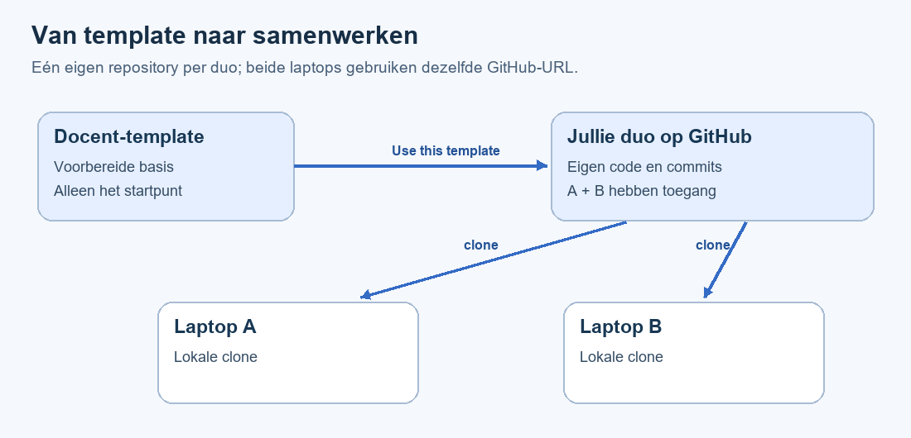
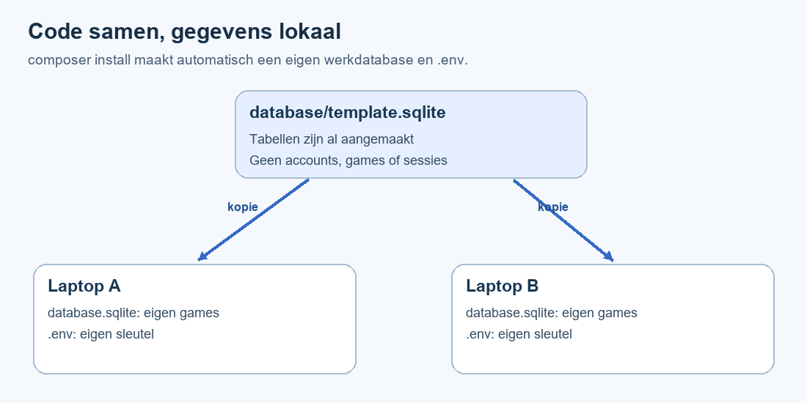
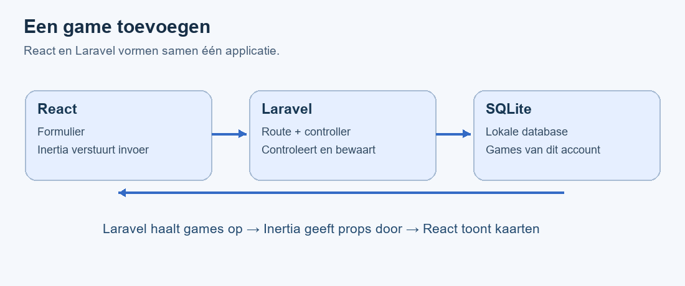
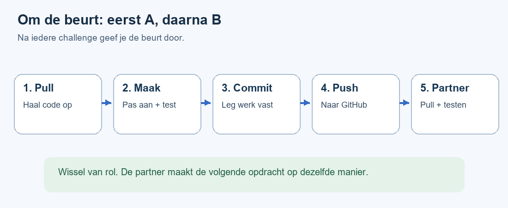

# Laravel + React Challenge — Game Backlog

**MBO4 Software Developer · versie 3 · 20 minuten uitleg + 2 lessen van 90 minuten**

Je hebt Git, Laravel en React geoefend. Nu combineer je ze in één applicatie. Je start met een voorbereid project op basis van de **officiële Laravel React Starter Kit voor Laravel 12**. Je installeert dit project op je eigen laptop en werkt alleen of met één partner.

---

### 🎮 Wat ga je bouwen?

Game Backlog is een persoonlijke lijst met games die je nog wilt spelen.

| Dit werkt al in de beginsituatie | Dit maak jij |
| --- | --- |
| Registreren, inloggen en uitloggen. | A: status wijzigen en bewaren. |
| Games toevoegen met titel en platform. | B: zoeken op titel. |
| Alleen je eigen games tonen. | C: uitgespeelde games tellen. |
| Ongeldige invoer afwijzen. | D: zoekveld leegmaken met een knop. |
| Gegevens opslaan in SQLite. | E: aantal zichtbare zoekresultaten tonen. |



*Illustratie van het doel. Status, zoeken en de teller zijn in jouw startproject bewust nog niet af. D en E zijn kleine extra opdrachten. Onderaan staat nog een optionele uitbreiding.*

---

### 🛠️ Benodigdheden

- Visual Studio Code, Git en je eigen GitHub-account.
- PHP **8.2, 8.3 of 8.4** en Composer. Controleer met `php -v` welke versie de terminal gebruikt.
- Node.js 22 LTS of 24 LTS en npm.
- De link naar de template-repository van je docent en internet.

De programma's ken je uit eerdere lessen. Je hebt geen Laravel-installer of MySQL nodig voor dit project. Een voorbereide SQLite-database zit al in de repository.

---

### ⏱️ Planning

De docent geeft vooraf 20 minuten uitleg. Daarna werk je twee keer 90 minuten.

| Les | Minuten | Werk |
| --- | --- | --- |
| 1 | 0–15 | Eigen duo-repository maken, partner uitnodigen en allebei klonen. |
| 1 | 15–35 | Op beide laptops installeren, starten en registreren. |
| 1 | 35–50 | Bestanden en gegevensstroom verkennen. |
| 1 | 50–65 | Games toevoegen en invoercontrole testen. |
| 1 | 65–80 | Samenwerken oefenen: ieder een wijziging committen, pushen en ophalen. |
| 1 | 80–90 | Kennischeck en tussenstand vastleggen. |
| 2 | 0–5 | Laatste code ophalen en starten. |
| 2 | 5–20 | Challenge A: status bewaren. |
| 2 | 20–40 | Challenge B: zoeken. |
| 2 | 40–50 | Challenge C: teller. |
| 2 | 50–60 | Kleine opdrachten D en E. |
| 2 | 60–80 | Testen en fouten herstellen. |
| 2 | 80–90 | Inleveren en einddemo. |

Opdracht F en de AI-opdrachten zijn optioneel. Het tempo gaat uit van werkende basisprogramma's uit eerdere lessen.

## Les 1 – Eigen repository, installatie en samenwerken

---

### 🎯 Leerdoelen

Na deze les kun je:

- vanuit een template een eigen repository maken en een partner uitnodigen;
- hetzelfde project op twee laptops installeren;
- uitleggen wat Laravel, React en Inertia doen;
- een game toevoegen en de invoercontrole testen;
- code uitwisselen met pull, commit en push;
- uitleggen waarom je lokale database niet wordt gesynchroniseerd.

---

### 📖 Template, repository en clone

De **template** is het startproject van de docent. Jullie **duo-repository** is een eigen project op GitHub. Een **clone** is de lokale kopie waarmee je op je laptop werkt.



**Maak één repository per duo.** Beide studenten klonen diezelfde repository. Maak dus niet ieder een aparte repository als je samen aan dezelfde code wilt werken. Werk je alleen, dan maak je je eigen repository en sla je het uitnodigen over.

---

### 🛠️ Opdracht 1 – Maak jullie eigen repository

1. Spreek af wie student A en student B is. A beheert de repository; beiden programmeren.
2. Student A opent op GitHub de template-link van de docent.
3. Kies **Use this template → Create a new repository**.
4. Kies je eigen account als eigenaar en bijvoorbeeld `game-backlog-duo` als naam.
5. Kies **Public**, zodat de docent de code kan bekijken. Laat **Include all branches** uit.
6. Klik op **Create repository**.
7. Student A opent in de nieuwe repository **Settings → Collaborators → Add people** en nodigt student B uit met diens GitHub-gebruikersnaam. GitHub kan om een wachtwoordbevestiging vragen.
8. Student B accepteert de uitnodiging op GitHub of via de uitnodigingsmail.

**Controlepunt:** de adresbalk toont jullie eigen accountnaam en repository. Student B heeft de uitnodiging geaccepteerd.

Alleen klonen maakt een project nog niet van jou: de clone blijft gekoppeld aan de repository waarvan je de URL gebruikt. Daarom maken we eerst de eigen duo-repository.

---

### 🛠️ Opdracht 2 – Kloon op beide laptops

Voer dit **ieder op je eigen laptop** uit:

1. Open jullie duo-repository op GitHub.
2. Klik op **Code → HTTPS** en kopieer de URL.
3. Open VS Code en druk op `Ctrl+Shift+P`.
4. Kies **Git: Clone**, plak de URL en kies een map voor schoolprojecten.
5. Kies **Open** als VS Code vraagt of je het project wilt openen. Vertrouw de map als dit jullie project is.
6. Open een terminal en controleer:

```shell
git remote -v
git branch --show-current
```

Bij `origin` staat **jullie duo-repository**, niet die van de docent. De branch is `main`. Je ziet in VS Code direct `artisan`, `composer.json`, `package.json` en `README.md`.

Heb je eerder de docentrepository gekloond en nog niets aangepast? Kloon jullie duo-repository in een nieuwe map en werk daarin. Heb je al werk gemaakt? Bewaar dat eerst en kopieer alleen je gewijzigde bronbestanden naar de nieuwe clone; zet geen `.env`, database of pakketmappen over.

---

### 🛠️ Opdracht 3 – Installeer het project

Controleer eerst:

```shell
php -v
composer --version
node -v
npm -v
git --version
```

Voer daarna in de projectmap uit, één opdracht tegelijk:

```shell
composer install
npm ci
```

Wacht steeds totdat de opdracht klaar is. Gebruik de meegestuurde lockbestanden; voer voor deze les geen `composer update` of `npm update` uit.

**Wat gebeurt er automatisch bij `composer install`?**

| Onderdeel | Wat gebeurt er? |
| --- | --- |
| PHP-pakketten | Composer installeert de vastgelegde versies in `vendor`. |
| `.env` | Het project maakt een lokale kopie van `.env.example`. |
| `APP_KEY` | Je krijgt een eigen willekeurige applicatiesleutel. |
| Database | `database/template.sqlite` wordt gekopieerd naar `database/database.sqlite`. |

Dit extra inrichten is een **meegeleverd script in dit lesproject**. Het gebeurt niet automatisch in ieder Laravel-project. Het script heet `scripts/setup-local.php`. Het overschrijft geen bestaande instellingen of database.

Je hoeft niets in `.env` in te vullen. Registratie en tabellen zijn voorbereid; een eigen account maak je straks zelf. Je hoeft voor de eerste start geen migraties te draaien.



**Let op:** `template.sqlite` bevat de tabellen, maar geen accounts, games of sessies. Werk altijd met `database.sqlite`. De template blijft ongewijzigd. Git negeert jouw `.env` en werkdatabase.

**Controlepunt:** je ziet nu `.env`, `vendor`, `node_modules` en `database/database.sqlite`. Bij Source Control staan deze lokale bestanden niet als wijzigingen.

---

### 🛠️ Opdracht 4 – Start en registreer

Open twee terminals in de projectmap en laat beide draaien.

```shell
# Terminal 1: Laravel
php artisan serve
```

```shell
# Terminal 2: React via Vite
npm run dev
```

Open **http://localhost:8000**. De andere poort die Vite laat zien is voor de frontend-ontwikkelserver; gebruik voor de app de Laravel-URL.

Klik op **Register**, maak een eigen lokaal testaccount en klik op **Open mijn games** in het dashboard. Gebruik een testwachtwoord dat je nergens anders gebruikt. Je hoeft geen e-mail te bevestigen.

Je ziet een lege lijst en een formulier. Dit is correct: iedere laptop heeft een eigen database.

**📷 Bewijs:** maak ieder een eigen screenshot van de draaiende app met de URL zichtbaar. Zet deze later in `bewijs/` en verwijs ernaar in `VOORTGANG.md`. Fotografeer geen wachtwoorden of de inhoud van `.env`.

---

### 📖 Laravel, React en Inertia

Laravel verwerkt verzoeken en bewaart gegevens. React maakt de gebruikersinterface. **Inertia** geeft de gegevens uit Laravel door aan een React-pagina als **props**.



In je eerdere Laravel-project gebruikte je Blade. Hier staat de pagina in `resources/js/pages/games/index.tsx`. Je maakt geen tweede React-project aan.

De Starter Kit gebruikt TypeScript: `.tsx` is JSX met types. Het type `Game` beschrijft de gegevens van één game. `Game[]` betekent een lijst van games. De benodigde types zijn al aanwezig.

---

### 🛠️ Opdracht 5 – Verken de basiscode

Zoek deze bestanden en vertel aan je partner wat ze doen:

| Bestand | Functie |
| --- | --- |
| `routes/web.php` | GET, POST en PATCH koppelen aan de controller. |
| `app/Http/Controllers/GameController.php` | Games ophalen, invoer controleren en opslaan. |
| `app/Models/Game.php` | Game-model en boolean-cast. |
| `database/migrations/2026_01_01_000000_create_games_table.php` | Beschrijving van de gamestabel. |
| `resources/js/pages/games/index.tsx` | Formulier, kaarten, zoekveld en teller. |
| `resources/css/game-backlog.css` | Opmaak van de gamepagina. |

Zoek in de controller:

```php
return Inertia::render('games/index', ['games' => $games]);
```

`games/index` verwijst naar de React-pagina. De sleutel `games` wordt de prop van de React-functie `Index`. De component `GameCard` ontvangt één game. `map()` maakt voor iedere game een kaart.

Zoek met de zoekfunctie van VS Code naar **TODO**. Je vindt precies drie startopdrachten. Laat deze nog staan tot les 2.

---

### 🛠️ Opdracht 6 – Voeg games toe en test

Voeg op **beide laptops** achtereenvolgens toe:

1. Rocket League — PlayStation.
2. Mario Kart 8 Deluxe — Switch.
3. Minecraft — PC.

Vernieuw de pagina. Je games moeten blijven staan. De nieuwste staat bovenaan. Status, zoeken en teller werken nog niet; die maak je zelf af.

Maak de titel leeg en klik op **Toevoegen**. Je verwacht **Vul een titel in.** en geen extra game.

| Onderdeel | Taak |
| --- | --- |
| `form.setData()` | Invoer bijhouden in React. |
| `form.post('/games')` | Invoer via Inertia versturen. |
| `$request->validate()` | Invoer controleren in Laravel. |
| `$game->save()` | Gegevens bewaren in de database. |
| `form.errors.title` | De foutmelding bij het veld tonen. |

Het formulier gebruikt `noValidate`, zodat je de controle van Laravel ziet. Alleen controle in de browser is onvoldoende.

---

### 💾 Samenwerken – Eén repository, twee laptops

Jullie werken in deze korte opdracht op `main`. **Eén student bewerkt de code; de ander kijkt mee en test.** Wissel na iedere opdracht. Spreek hardop af wie aan de beurt is. Zo voorkom je dat je tegelijk dezelfde regels aanpast.



| Stap | Betekenis | In VS Code |
| --- | --- | --- |
| Pull | Nieuwe commits van GitHub ophalen. | Source Control → … → Pull. |
| Aanpassen | Code wijzigen, opslaan en testen. | Werk in het bestand van de opdracht. |
| Stage | Kies welke wijzigingen in de commit komen. | Klik op `+` bij de bedoelde bestanden. |
| Commit | Een versie vastleggen op je eigen laptop. | Schrijf een duidelijke boodschap en klik Commit. |
| Push | Jouw commits naar jullie GitHub-repository sturen. | Source Control → … → Push. |
| Partner pull | De partner krijgt jouw nieuwe code. | Partner kiest Pull voordat die verder werkt. |

**Opslaan is geen commit. Een commit staat nog niet op GitHub: daarvoor is push nodig.** Klik bij het oefenen bewust op Pull en Push, zodat je de twee richtingen herkent.

Als VS Code om inloggen vraagt, gebruik je ieder je **eigen GitHub-account**. Vraagt Git om je naam en e-mailadres, stel die dan in deze repository in met de volgende opdrachten. Vervang de voorbeeldtekst door je eigen gegevens; je kunt het noreply-adres uit je GitHub-e-mailinstellingen gebruiken.

```shell
git config user.name "Jouw naam"
git config user.email "Jouw GitHub-e-mailadres"
```

Commit alleen broncode, documentatie en je bedoelde bewijsbestanden. `.env`, `database.sqlite`, `vendor` en `node_modules` blijven lokaal. Je wijzigt het meegestuurde `template.sqlite` niet.

---

### 🛠️ Opdracht 7 – Oefen een overdracht

**Eerst student A:**

1. Doe **Pull** en controleer dat Source Control geen openstaande wijzigingen toont.
2. Verander in `index.tsx` de ondertitel “Bewaar wat je nog wilt spelen.” in een eigen zin.
3. Sla op en bekijk de pagina in de browser.
4. Stage `index.tsx`, commit met `Eigen ondertitel toegevoegd` en doe **Push**.
5. Controleer op GitHub dat de commit zichtbaar is. Geef daarna de beurt aan B.

**Daarna student B:**

1. Doe **Pull** en controleer of de nieuwe ondertitel ook op jouw laptop verschijnt.
2. Vul jullie namen in `VOORTGANG.md` in.
3. Stage dit bestand, commit met `Namen duo toegevoegd` en doe **Push**.
4. Student A doet **Pull** en controleert de namen.

**Controlepunt:** jullie zien dezelfde twee nieuwe commits op beide laptops én op GitHub. Bij ieder is Source Control weer leeg. Jullie databases mogen verschillen; games worden niet via GitHub overgezet.

Werk je alleen? Voer de twee wijzigingen na elkaar uit en controleer na iedere push de commit op GitHub.

---

### 💡 Als pull of push niet lukt

| Melding of situatie | Doe dit |
| --- | --- |
| Geen toestemming / 403 | Controleer `git remote -v`, je eigen GitHub-account en of de uitnodiging is geaccepteerd. |
| Push rejected: remote contains work | Laat je partner even stoppen. Leg je eigen werk eerst vast met een commit, doe Pull, test de samengevoegde code en Push. |
| Pull geblokkeerd door lokale wijzigingen | Bekijk de wijzigingen. Maak een commit van werk dat je wilt bewaren voordat je Pull doet. Gooi werk niet zomaar weg. |
| Merge conflict | Open het conflicterende bestand in VS Code. Kies samen welke regels moeten blijven; “Accept Both” is niet altijd juist. Verwijder de conflictmarkeringen via de merge-editor, sla op, test, stage, commit en push. |
| Mijn partner heeft andere games | Dat klopt: accounts en games staan in de lokale database. Voeg testgames zelf toe. |

Gebruik geen **Force Push** voor deze les. Kom je er niet uit, laat de melding en het bestand aan de docent zien. Voorkomen is eenvoudiger: werk om de beurt en begin steeds met Pull.

---

### 🤖 AI-opdracht

Optioneel: vraag een korte uitleg over het verschil tussen Laravel, React en Inertia. Wijs daarna bij iedere rol een bestand in je eigen project aan. Neem alleen uitleg over die je zelf kunt toelichten.

---

### 🧠 Kennischeck

Beantwoord in `VOORTGANG.md`:

1. Wat is het verschil tussen de docenten-template, jullie repository en een clone?
2. Waarom ziet je partner een wijziging pas na jouw push en diens pull?
3. Welke bestanden worden bij de installatie lokaal aangemaakt?
4. Waarom krijgt je partner jouw games niet via GitHub?
5. Waar wordt de titel gecontroleerd en hoe komen de games bij React terecht?

---

### 📤 Inleveren – Tussenstand les 1

- Jullie eigen GitHub-link.
- Van ieder een screenshot van de eigen werkende installatie.
- Het overzicht met drie opgeslagen games en een screenshot van de validatiefout.
- De antwoorden en taakverdeling in `VOORTGANG.md`.
- Twee eigen oefencommits, waarvan bij een duo ieder er één heeft gemaakt.

## Les 2 – Laravel en React Challenge

---

### 🎯 Leerdoelen

Na deze les kun je een status in Laravel bewaren, met React-state zoeken, tellers uit props berekenen, twee kleine interfaceverbeteringen maken en de app testen met twee accounts. Je kunt je eigen programmeerwerk uitleggen en via GitHub overdragen.

---

### 🛠️ Opdracht 1 – Start en controleer

Doe op beide laptops **Pull** voordat je begint. Start `php artisan serve` en `npm run dev` in twee terminals. Log in en open `/games`. Controleer of je eigen drie games er nog zijn.

Spreek af wie A maakt, wie B maakt en wie C maakt. Wissel steeds na een werkende opdracht: **commit → push → partner pull**. De partner controleert de wijziging op de eigen laptop.

---

### 🛠️ Challenge A – Bewaar de status

Zoek **TODO 1** in `app/Http/Controllers/GameController.php`. Nu staat er:

```php
$game->completed = $game->completed;
```

Daardoor blijft de waarde hetzelfde. Pas zelf die regel aan: `false` moet `true` worden en `true` moet `false` worden. Laat de eigendomscontrole en `save()` staan.

**💡 Hint:** in PHP draait `!` een boolean om. Dit lijkt op het wisselen van een favoriet in React.

Test Mario Kart: markeren, vernieuwen, terugzetten en opnieuw vernieuwen. De status en knoptekst moeten beide keren kloppen. De teller klopt pas na C.

**Waarom de eigendomscontrole?** Inloggen vertelt wie je bent. De controle op `user_id` bepaalt of je deze specifieke game mag wijzigen.

---

### 💾 GitHub

Commit met `Challenge A - Status bewaren`, push en laat je partner pullen en testen.

---

### 🛠️ Challenge B – Zoek in je games

Zoek **TODO 2** in `resources/js/pages/games/index.tsx`. `visibleGames` is nu nog de volledige lijst. Maak zelf de zoekfunctie:

1. Gebruik `filter()` om passende games te selecteren.
2. Vergelijk de titel en zoektekst in kleine letters met `toLowerCase()`.
3. Gebruik `includes()` voor “bevat deze tekst”.
4. Gebruik `trim()` op de zoektekst, zodat spaties aan het begin en einde niet meetellen.
5. Een leeg zoekveld toont alle games.

**💡 Hint met andere gegevens:**

```tsx
const matches = names.filter((name) =>
    name.toLowerCase().includes(query.trim().toLowerCase())
);
```

Jouw array bevat game-objecten. Gebruik de titel-eigenschap van ieder object. De bestaande `map()` gebruikt `visibleGames` al.

Test `MARIO`, daarna ` mario ` en daarna `zzzz`. Je verwacht één kaart, één kaart en “Geen games gevonden”. Maak het veld leeg: alle drie kaarten zijn terug.

---

### 📖 Props en state

`games` is een prop uit Laravel. `search` is tijdelijke state in React. Zoeken verandert welke kaarten je ziet, maar verwijdert geen games. Bij vernieuwen verdwijnt de zoektekst; opgeslagen games blijven bestaan.

---

### 💾 GitHub

Commit met `Challenge B - Zoeken op titel`, push en laat je partner pullen en testen.

---

### 🛠️ Challenge C – Tel de uitgespeelde games

Zoek **TODO 3** in `index.tsx`. `completedCount` is nu altijd nul.

Selecteer met `filter()` de games waarvan `completed` waar is en gebruik `.length` om ze te tellen.

**💡 Hint:** gebruik de oorspronkelijke array `games`. De totaalstand mag niet veranderen als je zoekt.

Test drie games waarvan één uitgespeeld is. Je verwacht “1 van 3 uitgespeeld”. Zoek één titel: de teller blijft gelijk. Markeer een tweede game: de teller wordt “2 van 3 uitgespeeld”.

Commit met `Challenge C - Teller toegevoegd`, push en draag de beurt over.

---

### 🛠️ Kleine opdracht D – Maak het zoeken leeg

Voeg bij het zoekveld een knop **Wis zoeken** toe. Bij klikken wordt het zoekveld leeg en verschijnen alle games weer.

- Geef de knop `type="button"` en bijvoorbeeld `className="gb-secondary"`.
- Gebruik een `onClick`-functie met de bestaande setter `setSearch`.
- Je hebt geen Laravel-route of databasewijziging nodig.

**💡 Hint:** welke tekst moet in `search` staan als het veld leeg is?

Test: zoek `mario`, klik op de knop en controleer het veld en alle drie kaarten. Commit en draag over.

---

### 🛠️ Kleine opdracht E – Toon hoeveel resultaten je ziet

Voeg onder de kop **Mijn games** een tekst toe zoals **Zichtbaar: 1 van 3**. Gebruik JSX om de aantallen te berekenen.

**💡 Hint:** `visibleGames.length` geeft het aantal kaarten na zoeken. `games.length` geeft het totaal. Maak hiervoor geen nieuwe state.

Test: zonder zoektekst 3 van 3, bij `mario` 1 van 3 en bij `zzzz` 0 van 3. De teller “uitgespeeld” blijft de totale voortgang tonen. Commit en push.

---

### 🛠️ Opdracht 2 – Test je applicatie

Gebruik de tabel in `VOORTGANG.md`. Noteer de werkelijke uitkomst en “geslaagd” of “nog herstellen”. Test na een reparatie opnieuw.

| Test | Verwacht |
| --- | --- |
| Toevoegen en vernieuwen. | Game blijft in de lijst. |
| Lege titel versturen. | “Vul een titel in.”; geen extra game. |
| Titel met 81 tekens versturen. | “Gebruik maximaal 80 tekens.”; geen extra game. |
| Status heen en terug wijzigen, telkens vernieuwen. | De nieuwe status blijft beide keren opgeslagen. |
| `MARIO` en ` mario ` zoeken. | Beide vinden Mario Kart. |
| `zzzz` zoeken. | Geen kaarten, wel de melding “Geen games gevonden”. |
| Zoeken met één uitgespeelde game van drie. | De voortgang blijft “1 van 3 uitgespeeld”. |
| Wis zoeken gebruiken. | Zoekveld leeg en alle kaarten terug. |
| Resultatenteller controleren. | 3 van 3, 1 van 3 en 0 van 3 bij de voorbeelden hierboven. |
| Uitloggen en `/games` openen. | Je komt bij het inlogscherm. |
| Tweede account op dezelfde laptop maken. | Nieuwe, lege collectie. |
| Code pushen en partner laten pullen. | Partner ziet de codewijziging, maar behoudt eigen accounts en games. |

Voor 81 tekens: plak drie keer direct achter elkaar `abcdefghijklmnopqrstuvwxyz1`.

Ga via **Terug naar dashboard** naar het accountmenu en kies **Log out**. Registreer een tweede lokaal account. Voeg één game toe, log uit en ga terug naar het eerste account. Dat account toont uitsluitend zijn eigen games.

Wijs ook de eigendomscontrole van `toggle()` aan. Een game verbergen is niet genoeg: de server moet wijzigingen aan games van anderen weigeren. De meegeleverde basistests controleren dit.

**Extra controle:** voer in een derde terminal `php artisan test --filter=Game` uit. Die tests controleren de voorbereide basis en de eigendomscontrole. Ze vervangen je handmatige tests van zoeken, status en tellers niet.

---

### 🤖 AI-opdracht

Optioneel: laat AI uitleggen waarom `completedCount` uit `games` berekend kan worden zonder aparte `useState`. Controleer de uitleg met drie games. Schrijf maximaal drie eigen zinnen op.

---

### 🧠 Kennischeck

Beantwoord in `VOORTGANG.md`:

1. Waarom heeft de status een Laravel-route en `save()` nodig?
2. Wat is het verschil tussen inloggen en eigenaar zijn van een game?
3. Wat zijn props en state in deze pagina?
4. Waarom gebruikt de voortgang `games` en de resultatenteller `visibleGames`?
5. Waarom heeft “Wis zoeken” geen database nodig?
6. Welke code heb je zelf gemaakt, getest en via GitHub overgedragen?

---

### 📤 Inleveren – Eindresultaat

Lever één GitHub-link per duo of individuele student in via Canvas. Controleer op GitHub of je laatste commit er staat. Vul `VOORTGANG.md` in met:

- Jullie namen en wie welke onderdelen heeft gemaakt en getest.
- Per student een screenshot van de eigen draaiende installatie.
- Eigen screenshots van overzicht, zoeken en validatiefout, opgeslagen in `bewijs/`.
- De ingevulde testtabel en kennischecks.
- Een korte uitleg van jullie overdracht via GitHub.

Gebruik de illustraties uit de module niet als eigen bewijs. De installatie-instructies staan al in `README.md`; controleer of een ander ze kan volgen.

### 🎤 Einddemo – Twee minuten

Voeg een game toe, markeer hem, vernieuw, zoek hem en wis de zoektekst. Laat de fout bij een lege titel zien. Beide studenten wijzen een Laravel-regel en een React-regel aan en leggen die uit. Toon één commit van ieder.

### ✅ Wanneer ben je klaar?

Beide laptops werken, A tot en met E slagen, de tests zijn ingevuld en de laatste code staat op GitHub. Je kunt uitleggen wat je zelf hebt geprogrammeerd. De overgenomen basiscode is het startpunt; je eigen werk zit in de challenges, uitbreidingen, tests en samenwerking.

## Hulp en extra uitdaging

---

### 🚀 Optionele opdracht F – Alleen nog te spelen games

Heb je A tot en met E getest? Voeg dan een checkbox **Alleen nog spelen** toe.

1. Maak een boolean-state, bijvoorbeeld `onlyTodo`, met beginwaarde `false`.
2. Koppel de checkbox met `checked` en `onChange` aan deze state.
3. Combineer het statusfilter met je bestaande zoekfilter.
4. Als de checkbox uit staat, tellen beide statussen mee. Als hij aan staat, alleen games met `completed === false`.

**💡 Hint:** combineer de zoekvoorwaarde en de statusvoorwaarde met `&&`. De voortgang blijft gebaseerd op alle games; de resultatenteller op de zichtbare games.

Test met twee nog te spelen games en één uitgespeelde game. Checkbox aan toont twee games. Zoeken moet tegelijk blijven werken. Checkbox uit herstelt beide statussen binnen de huidige zoekopdracht.

---

### 💡 Vastgelopen?

| Probleem | Controle |
| --- | --- |
| Programma niet herkend. | Controleer de installatie uit vorige lessen en heropen VS Code. |
| Composer meldt verkeerde PHP-versie. | Voer `php -v` uit. Dit template vraagt minimaal PHP 8.2; controleer welk PHP-programma je terminal gebruikt. |
| SQLite-driver ontbreekt. | Bekijk `php --ini` en `php -m`; schakel `pdo_sqlite` in de gebruikte PHP-configuratie in en herstart Laravel. |
| `.env` of werkdatabase ontbreekt. | Voer `composer run setup-local` uit. Gebruik geen `--no-scripts` bij de installatie. |
| No application encryption key. | Controleer of `.env` bestaat en de regel `APP_KEY=` bevat. Bij een lege waarde helpt `composer run setup-local`. Deel de sleutel niet. |
| Composer-installatie faalt. | Lees de eerste echte fout; controleer de genoemde PHP-extensie. Sla versie- of extensiecontroles niet over. |
| `npm ci` mislukt. | Controleer Node-versie, internet en of `package-lock.json` aanwezig is. |
| Vite manifest ontbreekt. | Laat `npm run dev` draaien in een tweede terminal. |
| Wijziging niet zichtbaar. | Sla op, controleer de Vite-terminal en vernieuw de Laravel-URL. |
| Poort 8000 bezet. | Stop je andere lokale Laravel-project, of gebruik de door `artisan serve` gemelde poort. |
| Windows: Failed to listen, terwijl de poort vrij is. | Probeer `php artisan serve --no-reload`. Deze optie omzeilt een probleem met doorgeven van omgevingsvariabelen. Herstart Laravel zelf als je later `.env` wijzigt. |
| 419 / Page Expired. | Vernieuw, log opnieuw in en gebruik steeds dezelfde hostnaam, bijvoorbeeld `localhost`. |
| 403 bij een game wijzigen. | Controleer of die game van het ingelogde account is. |

Na een gewone pull met alleen PHP-, React- of CSS-wijzigingen hoef je niets opnieuw te installeren. Is `composer.lock` veranderd, voer dan `composer install` uit. Is `package-lock.json` veranderd, voer dan `npm ci` uit. Zijn er nieuwe migraties toegevoegd, voer dan `php artisan migrate` uit. Die wijzigingen zijn niet nodig voor A tot en met F.

Verwijder je database niet om een foutmelding kwijt te raken: dan verlies je je lokale accounts en games.

---

### 🔗 Bronnen

De opbouw met leerdoelen, uitleg, opdrachten, GitHub, kennischecks en inleveren sluit aan op [React 1 – Basis](https://www.roc.ovh/books/software-development-20252627/page/react-1-basis).

Technische basis: [Laravel 12 Starter Kits](https://laravel.com/docs/12.x/starter-kits), [officiële React Starter Kit v1.0.0](https://github.com/laravel/react-starter-kit/tree/v1.0.0) en [GitHub: een repository maken vanuit een template](https://docs.github.com/en/repositories/creating-and-managing-repositories/creating-a-repository-from-a-template). Gecontroleerd op 7 oktober 2026.
